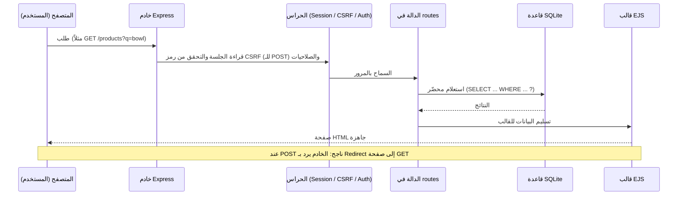
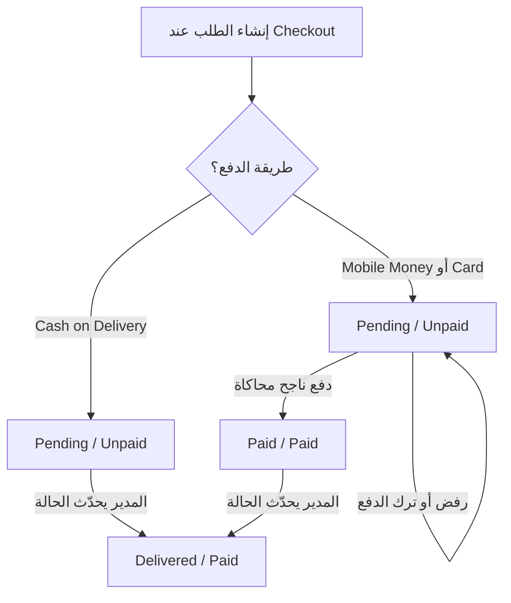
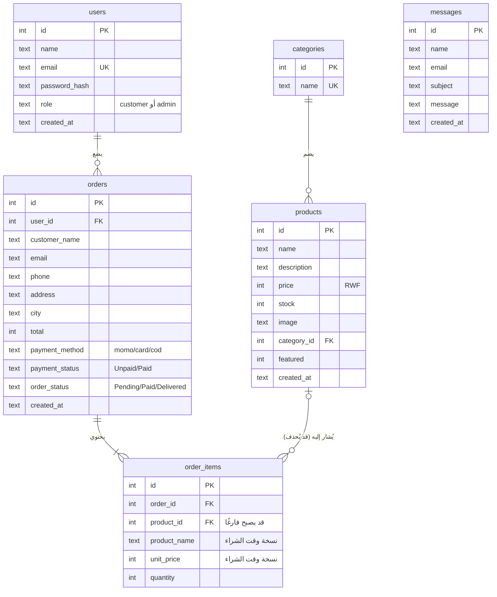

<div dir="rtl">

# دليل مشروع Woodora بالعربية: البنية، قاعدة البيانات، الرحلات، وHCI

> **ما الذي راجعناه لكتابة هذا الدليل؟** قرأنا الكود الفعلي (`server.js` و`routes/` و`middleware/` و`helpers/` و`views/` و`public/` و`db/`)، وملفات `PROJECT_GUIDE.md` و`TESTING_CHECKLIST.md`، وملف قاعدة البيانات `db/woodora.db` وملف التصدير `db/woodora-export.sql`، ووثيقة **"Day 6 & 7 HCI ASSIGNMENTS.pdf"** (واجبات الأسبوعين 6 و7). **لا يوجد** ملف README ولا ملف متطلبات المحاضر داخل المشروع (انظر ملف مراجعة المتطلبات).
> **ما كُتب هنا هو ما يفعله النظام فعلًا.** ما هو غير موجود ذكرناه صراحة.

**المحتويات**

1. [نظرة عامة](#1-نظرة-عامة)
2. [هيكل المجلدات](#2-هيكل-المجلدات)
3. [كيف يعمل النظام تقنيًا](#3-كيف-يعمل-النظام-تقنيًا)
4. [الجلسات وكلمات السر والتحقق والأمان](#4-الجلسات-وكلمات-السر-والتحقق-والأمان)
5. [قاعدة البيانات](#5-قاعدة-البيانات-بالعربية-البسيطة)
6. [رحلة العميل](#6-رحلة-العميل-customer-journey)
7. [رحلة المدير والفرق بينه وبين العميل](#7-رحلة-المدير-administrator-journey)
8. [Woodora ومفاهيم HCI](#8-woodora-ومفاهيم-hci)
9. [حدود المشروع والفروق بين التوثيق والتنفيذ](#9-حدود-المشروع-والفروق-بين-التوثيق-والتنفيذ)

---

## 1. نظرة عامة

**Woodora** متجر إلكتروني لأدوات المطبخ الخشبية، مبني كمشروع جامعي. العميل يتصفح المنتجات، يضع ما يريد في السلة، يسجّل بياناته ويدفع (محاكاة) أو يختار الدفع عند الاستلام، ثم يتابع طلبه. والمدير يدير المنتجات والطلبات والرسائل.

**شعار المشروع:** "بسيط في التعقيد، احترافي في الجودة" (Basic in complexity, professional in quality).

**التقنيات المستخدمة (كما هي مثبتة في `package.json` وعلى الجهاز):**

| الجزء | التقنية | الإصدار المثبّت | وظيفتها بكلمات بسيطة |
|---|---|---|---|
| بيئة التشغيل | Node.js | v23.11.0 (على جهازنا) | تشغّل الجافاسكريبت خارج المتصفح |
| الخادم | Express | 5.3.0 | يستقبل الطلبات ويرد عليها |
| القوالب | EJS | 7.0.2 | يملأ صفحات HTML بالبيانات |
| قاعدة البيانات | SQLite عبر `better-sqlite3` | 13.0.3 | قاعدة بيانات في ملف واحد `db/woodora.db` |
| الجلسات | `express-session` | 1.19.0 | يتذكر المستخدم بين الصفحات |
| تشفير كلمات السر | `bcryptjs` | 3.0.3 | يحوّل كلمة السر إلى هاش |
| الإعدادات السرية | `dotenv` | 18.0.9 | يقرأ ملف `.env` |
| الواجهة | HTML + CSS + قليل من JavaScript | — | الشكل والتفاعل |

> **ملاحظة:** جرّبنا المشروع فعليًا على Node.js v23.11.0 فقط. ملف `PROJECT_GUIDE.md` القديم يذكر "Node.js 18 أو أحدث" ولم نتحقق من ذلك. الأفضل استخدام نفس الإصدار أو أحدث.

**تشغيل المشروع:**

```
npm install            # تنزيل المكتبات
cp .env.example .env   # إنشاء ملف الإعدادات (ثم عدّلوا كلمة سر المدير)
npm run setup          # إنشاء الجداول والمنتجات وحساب المدير
npm start              # تشغيل الموقع على http://localhost:3000
```

---

## 2. هيكل المجلدات

```
WOOdora/
├── server.js              نقطة البداية: يشغّل Express والجلسات ويربط كل الأجزاء
├── package.json           قائمة المكتبات وأوامر npm run setup / npm start
├── .env                   إعدادات سرية (كلمة سر المدير، سر الجلسات)  ← لا تُشارَك
├── .env.example           نموذج للملف أعلاه
├── db/
│   ├── schema.sql         تعريف الجداول الستة
│   ├── database.js        يفتح ملف قاعدة البيانات
│   ├── seed.js            ينشئ الجداول + 4 تصنيفات + 13 منتجًا + حساب المدير
│   ├── woodora.db         ملف قاعدة البيانات نفسه
│   └── woodora-export.sql نسخة نصية من القاعدة (SQL)
├── routes/                الروابط: كل ملف لجزء من الموقع
│   ├── pages.js           الرئيسية، Mission، Impact، نموذج الاتصال
│   ├── shop.js            المنتجات + البحث + تفاصيل المنتج
│   ├── cart.js            إضافة/تعديل/حذف من السلة
│   ├── auth.js            التسجيل، دخول العميل، دخول المدير، الخروج
│   ├── checkout.js        إتمام الطلب، الدفع (محاكاة)، طلباتي
│   └── admin.js           كل صفحات المدير
├── middleware/            حراس يعملون قبل الروابط
│   ├── auth.js            requireLogin و requireAdmin وتنظيف روابط العودة
│   └── csrf.js            حماية النماذج من التزوير (CSRF)
├── helpers/cart.js        قراءة السلة والتحقق من الأسعار والمخزون
├── views/                 قوالب EJS (شكل الصفحات)
│   ├── partials/          أجزاء مشتركة: الترويسة، التذييل، البطاقة، الأيقونات...
│   └── admin/             صفحات المدير
├── public/                ما يحمّله المتصفح مباشرة
│   ├── css/style.css      ملف التصميم الوحيد
│   ├── js/main.js         قائمة الجوال، تأكيد الحذف، إغلاق الرسائل، معاينة الصورة
│   └── images/            صور المنتجات والخلفية
└── _original/             نسخة احتياطية من الموقع الأول (HTML ثابت فقط)
```

---

## 3. كيف يعمل النظام تقنيًا

### 3.1 الواجهة الأمامية (Frontend)

- **HTML** تُولَّد من قوالب EJS في `views/`.
- **CSS** في ملف واحد `public/css/style.css`. الألوان والخطوط معرَّفة في أعلاه (`:root`): بني، ذهبي، كريمي، وخط Georgia للعناوين وArial للنص. فيه أيضًا قواعد الجوال والتابلت.
- **JavaScript** قليل جدًا (`public/js/main.js`)، وله أربع وظائف فقط:
  1. فتح/إغلاق قائمة الجوال.
  2. نافذة "هل أنت متأكد؟" قبل الحذف.
  3. إغلاق رسائل التنبيه بزر ×.
  4. معاينة صورة المنتج في نموذج المدير.
- **منطق المتجر كله في الخادم**، وليس في الجافاسكريبت. هذا مقصود: ما يحدث في المتصفح يمكن العبث به، أما الخادم فلا.

### 3.2 الواجهة الخلفية (Backend)

- ملف `server.js` يجهّز كل شيء ثم يشغّل الخادم على المنفذ 3000.
- يضيف رؤوس أمان بسيطة (`X-Content-Type-Options`, `X-Frame-Options`, `Referrer-Policy`) ويحدّ حجم النماذج بـ 20 كيلوبايت.
- ثم يمرر كل طلب على ثلاث مراحل: **الجلسة ← رمز CSRF ← الرابط المناسب**.
- ملفات `routes/` تحتوي دوال، كل دالة مسؤولة عن رابط (مثل `GET /products` أو `POST /cart/add`).

### 3.3 قاعدة البيانات

SQLite ملف واحد. نتعامل معها بمكتبة `better-sqlite3` بأوامر مثل:

```
db.prepare('SELECT * FROM users WHERE email = ?').get(email)
```

علامة `?` تعني أن القيمة تُرسل **منفصلة** عن نص الأمر، وهذا ما يمنع **حقن SQL**.

### 3.4 رحلة الطلب بين المتصفح والخادم والقاعدة



### 3.5 مخطط حياة الطلب (حالاته)



> في كل حالة يستطيع المدير تغيير **order_status** و**payment_status** يدويًا من شاشة تفاصيل الطلب. المخطط أعلاه يوضح **المسار الطبيعي** فقط.

---

## 4. الجلسات وكلمات السر والتحقق والأمان

### 4.1 الجلسة (Session) وملف التعريف (Cookie)

- عند أول زيارة يعطي الخادم المتصفح **Cookie** اسمه `connect.sid` فيه **رقم جلسة فقط**.
- بيانات الجلسة نفسها (من أنت؟ ما دورك؟ ما في سلتك؟) **محفوظة في ذاكرة الخادم**، وليس عند المستخدم.
- إعدادات الـ Cookie: `httpOnly` (لا يقرؤه جافاسكريبت الصفحة)، و`sameSite: lax`، وصلاحية **8 ساعات**.
- **السلة** و**الدور** (`customer`/`admin`) وبيانات الدفع المؤقتة (رقم الهاتف المخفي) كلها داخل الجلسة.
- عند تسجيل الدخول **تُجدَّد الجلسة** (رقم جديد) لحماية المستخدم من تثبيت الجلسة، مع نقل السلة.
- **حدّ مهم:** الجلسات في الذاكرة (`MemoryStore`)، فإعادة تشغيل الخادم تسجّل خروج الجميع وتفرغ السلال. الطلبات والمنتجات في القاعدة لا تتأثر.

### 4.2 تشفير كلمات السر (Password Hashing)

- نستخدم **bcrypt** بدرجة تكلفة 10.
- ما يُخزَّن هو **الهاش** مثل `$2b$10$....` وليس كلمة السر. لا يمكن استرجاع كلمة السر منه.
- عند الدخول: نأخذ كلمة السر المكتوبة ونقارنها بالهاش عبر `bcrypt.compareSync`.
- يمكنكم التأكد بأنفسكم: افتحوا جدول `users` في برنامج DB Browser for SQLite وانظروا العمود `password_hash`.

### 4.3 التحقق من المدخلات (Server-side Validation)

كل نموذج يمر عبر تحقق في الخادم (حتى لو تخطّى أحدهم المتصفح). والنماذج تحمل `novalidate`، أي أن **الخادم** هو مصدر رسائل الخطأ.

| النموذج | أهم القواعد |
|---|---|
| التسجيل | اسم 2-60، بريد صحيح وفريد، كلمة سر 8+ مع حرف ورقم، تطابق التأكيد |
| الدخول | بريد وكلمة سر، رسالة خطأ موحّدة |
| الاتصال | اسم، بريد، موضوع 3-100، رسالة 10-1000 |
| الدفع (Checkout) | اسم، بريد، هاتف 9-15 رقمًا، عنوان 5-200، مدينة، طريقة دفع من القائمة |
| Mobile Money | رقم رواندي صحيح (مثل 07x...) |
| البطاقة | 16 رقمًا، تاريخ MM/YY غير منتهٍ، CVV من 3 أرقام |
| منتج (مدير) | اسم 2-80، سعر صحيح 1-10,000,000، مخزون 0-100,000، تصنيف موجود، صورة من القائمة |
| الحالة (مدير) | قيمة من قائمة مسموحة فقط |

### 4.4 قائمة إجراءات الأمان (وما يقابلها في الكود)

| الخطر | الحماية | أين؟ |
|---|---|---|
| سرقة كلمات السر | تخزين هاش bcrypt | `routes/auth.js` |
| حقن SQL | استعلامات محضّرة (`?`) في كل الملفات | كل `routes/` |
| دخول العميل لصفحات المدير | `requireAdmin` على كل `/admin` | `middleware/auth.js`, `routes/admin.js` |
| تزوير الأسعار/المجاميع | الأسعار تُقرأ من القاعدة، النموذج لا يرسلها | `helpers/cart.js`, `routes/checkout.js` |
| الشراء بأكثر من المخزون | فحص عند السلة + فحص ذري عند الطلب | `routes/cart.js`, `routes/checkout.js` |
| تزوير النماذج من موقع آخر (CSRF) | رمز سري في كل نموذج POST | `middleware/csrf.js` |
| حقن كود في الصفحة (XSS) | تهريب المخرجات تلقائيًا في EJS (`<%= %>`) | كل `views/` |
| رؤية طلبات الآخرين | الاستعلام يتحقق من `user_id` | `routes/checkout.js` |
| تحويل المستخدم لموقع خبيث | `next` يقبل صفحات داخلية فقط | `middleware/auth.js` |
| دفع الطلب مرتين | `WHERE payment_status = 'Unpaid'` | `routes/checkout.js` |
| تخزين بيانات البطاقة | لا تُخزَّن ولا تُعاد للصفحة | `routes/checkout.js` |
| تخمين وجود بريد معين | رسالة خطأ موحّدة | `routes/auth.js` |

**ما لم يُنفَّذ (قيود حقيقية):** HTTPS وCookie من نوع `secure` (مطلوبان عند النشر على الإنترنت)، تحديد عدد محاولات الدخول، سياسة CSP، تخزين جلسات دائم، استرجاع كلمة السر، وسجل تدقيق (Audit log) لعمليات المدير.

---

## 5. قاعدة البيانات بالعربية البسيطة

القاعدة فيها **6 جداول** فقط (كلها موجودة في `db/schema.sql` وفي ملف التصدير). الجدول `sqlite_sequence` داخلي من SQLite ولا نتعامل معه.

### 5.1 مخطط العلاقات



> جدول `messages` **مستقل** تمامًا: لا علاقة له بالمستخدمين أو الطلبات.

### 5.2 شرح كل جدول

#### جدول `users` (المستخدمون)
- **وظيفته:** كل الحسابات (عملاء ومدير) في جدول واحد.
- **أهم الأعمدة:** `email` (فريد، يُستخدم للدخول)، `password_hash` (هاش وليس كلمة السر)، `role` (إما `customer` أو `admin`، وقاعدة CHECK تمنع أي قيمة أخرى).
- **علاقاته:** مستخدم واحد ← طلبات كثيرة (`orders.user_id`).

#### جدول `categories` (التصنيفات)
- **وظيفته:** تصنيفات المنتجات. أربعة تصنيفات: Utensils, Bowls & Plates, Trays & Boards, Sets.
- **أهم الأعمدة:** `name` (فريد).
- **علاقاته:** تصنيف واحد ← منتجات كثيرة.

#### جدول `products` (المنتجات)
- **وظيفته:** ما يُباع: 13 منتجًا.
- **أهم الأعمدة:** `price` (عدد صحيح بالفرنك الرواندي، يجب أن يكون أكبر من 0)، `stock` (المخزون، لا يقل عن 0)، `image` (اسم ملف داخل `public/images`)، `category_id`، `featured` (1 = يظهر في الرئيسية).
- **علاقاته:** ينتمي لتصنيف واحد، ويُشار إليه من `order_items`.

#### جدول `orders` (الطلبات)
- **وظيفته:** رأس كل طلب: من طلب، أين يُوصَّل، كم الإجمالي، كيف يدفع، وما حالته.
- **أهم الأعمدة:**
  - `user_id`: صاحب الطلب.
  - `customer_name, email, phone, address, city`: **بيانات التوصيل وقت الطلب** (تُحفَظ نسخة حتى لو غيّر العميل بياناته).
  - `total`: **يُحسب في الخادم**.
  - `payment_method`: `momo` أو `card` أو `cod`.
  - `payment_status` (Unpaid/Paid) و`order_status` (Pending/Paid/Delivered): **منفصلتان عمدًا**.
- **علاقاته:** ينتمي لمستخدم، ويحتوي سطور `order_items`.

#### جدول `order_items` (سطور الطلب)
- **وظيفته:** كل منتج داخل الطلب.
- **أهم الأعمدة:** `product_name` و`unit_price`: **نسخة من اسم المنتج وسعره وقت الشراء**، و`quantity`.
- **علاقاته:** `order_id` (إذا حُذف الطلب تُحذف سطوره: `ON DELETE CASCADE`) و`product_id` (إذا حُذف المنتج يصبح الحقل فارغًا `NULL` وتبقى السطور: `ON DELETE SET NULL`).

#### جدول `messages` (الرسائل)
- **وظيفته:** رسائل نموذج "اتصل بنا".
- **أهم الأعمدة:** `name, email, subject, message, created_at`.
- **علاقاته:** لا يوجد.

### 5.3 مثال عملي: ماذا يحدث في القاعدة عند طلب؟

**السيناريو (مثال توضيحي):** "أمل" تشتري **وعاءين (12,000 لكل)** و**صينية (15,000)** وتدفع بـ Mobile Money.

**1) أثناء التسوق:** لا يتغير شيء في القاعدة. السلة داخل الجلسة فقط.

**2) عند الضغط على Place order** (معاملة واحدة):

| الجدول | ماذا يتغير؟ |
|---|---|
| `products` | مخزون Wooden Bowl: 20 ← **18**، ومخزون Wooden Serving Tray: 15 ← **14** |
| `orders` | صف جديد: `user_id`=أمل، `total`=**39000**، `payment_method`=momo، `payment_status`=**Unpaid**، `order_status`=**Pending** |
| `order_items` | صفان: (Wooden Bowl، 12000، الكمية 2) و(Wooden Serving Tray، 15000، الكمية 1) |

**3) بعد الضغط على "I approved the payment":** في جدول `orders` فقط يتغير `payment_status` إلى **Paid** و`order_status` إلى **Paid**. لا يُخزَّن أي رقم هاتف دفع أو بطاقة.

**4) لاحقًا يضغط المدير Save بعد التسليم:** `order_status` ← **Delivered**.

**مثال حقيقي من القاعدة الحالية:** في ملف `db/woodora.db` الآن طلب تجريبي واحد: Wooden Utensil Holder × 1، السعر 8000، الدفع عند الاستلام (`cod`)، الحالة Pending/Unpaid، ومخزون المنتج نزل من 25 إلى 24. هذا يثبت أن العملية تعمل على الجهاز.

### 5.4 تصدير القاعدة واستيرادها

```
sqlite3 db/woodora.db .dump > db/woodora-export.sql      # تصدير
sqlite3 db/new.db < db/woodora-export.sql                # استيراد في ملف جديد
```

> **تنبيه:** ملف `db/woodora-export.sql` الموجود **نسخة قديمة** أُخذت قبل بعض الاختبارات، وهو يحتوي حساب المدير والمنتجات والتصنيفات فقط (بدون العميل التجريبي والطلب التجريبي الموجودين في `woodora.db`). نفّذوا أمر التصدير مرة أخرى قبل التسليم إن أردتم نسخة محدّثة.
> **لإعادة البدء من الصفر:** أوقفوا الخادم، احذفوا `db/woodora.db`، ثم نفّذوا `npm run setup`.

---

## 6. رحلة العميل (Customer Journey)

لكل خطوة: الشاشة، ما يفعله العميل، ما يُنقَل بين الصفحات، وما يُحفظ.

| # | الخطوة | الشاشة | ما يحدث | ما يُحفظ وأين؟ |
|---|---|---|---|---|
| 1 | دخول الموقع | الرئيسية `/` | عرض المميز والتصنيفات | لا شيء |
| 2 | تصفح المنتجات | `/products` | عرض 13 منتجًا | لا شيء |
| 3 | البحث والتصنيف | `/products?q=..&category=..` | تصفية في الخادم | لا شيء (تُرسَل في الرابط) |
| 4 | التفاصيل | `/products/:id` | عرض منتج واحد | لا شيء |
| 5 | إضافة للسلة | `POST /cart/add` | يُرسل **رقم المنتج والكمية** فقط | **الجلسة** (رقم ← كمية) |
| 6 | تعديل السلة | `/cart` | + / − / Remove | **الجلسة** |
| 7 | بدء الدفع | `/checkout` | إن لم يكن مسجلًا يُحوَّل لـ `/login/customer` | — |
| 8 | تسجيل حساب جديد | `/register` | تحقق + هاش + إدخال | **جدول users**، والجلسة تحفظ الهوية |
| 9 | تسجيل الدخول | `/login/customer` | تحقق من الهاش وتجديد الجلسة | **الجلسة** (الهوية والدور) مع بقاء السلة |
| 10 | بيانات التوصيل | `/checkout` | اسم، بريد، هاتف، عنوان، مدينة | تُحفظ عند الإرسال في **orders** |
| 11 | اختيار طريقة الدفع | `/checkout` | momo / card / cod | عمود `payment_method` |
| 12 | تأكيد الطلب | `POST /checkout` | معاملة: خصم مخزون + إنشاء طلب وسطوره | **products** (المخزون) + **orders** + **order_items**، وتفرغ السلة |
| 13 | الدفع (إلا COD) | `/orders/:id/pay` | محاكاة | عند النجاح: تحديث **orders** (Paid/Paid) |
| 14 | تأكيد الطلب | `/orders/:id` | عرض الطلب والحالة | لا شيء |
| 15 | متابعة الطلب | `/orders` | قائمة طلباتي | لا شيء |

**ترتيب الدخول:** يمكن للزائر **تصفح الموقع ووضع منتجات في السلة بدون حساب**. الحساب مطلوب **عند Checkout فقط**.

**خطوات غير موجودة أو ناقصة (يجب ذكرها بصدق):**
- لا يوجد شراء كضيف (Guest checkout).
- لا يوجد بريد تأكيد، ولا إشعارات.
- لا يمكن إلغاء الطلب أو تعديله بعد إنشائه.
- لا توجد عناوين محفوظة ولا قائمة أمنيات.
- رسوم التوصيل نص ثابت "Free (demo)" وليست حسابًا حقيقيًا.
- لا يوجد تتبع للشحنة؛ فقط حالة الطلب (Pending/Paid/Delivered).
- لا يوجد استرجاع كلمة السر.

---

## 7. رحلة المدير (Administrator Journey)

| # | الخطوة | الشاشة | ماذا يحدث؟ |
|---|---|---|---|
| 1 | الدخول | `/admin/login` | يكتب بريده وكلمة سره |
| 2 | التحقق من الصلاحية | (في الخلفية) | يتحقق من الهاش **ثم** أن الدور `admin`. العميل يُرفض بـ 403 |
| 3 | لوحة التحكم | `/admin` | إحصاءات وآخر 5 طلبات |
| 4 | مشاهدة الطلبات | `/admin/orders` | قائمة + تصفية بالحالة |
| 5 | إدارة المنتجات | `/admin/products` | قائمة كل المنتجات |
| 6 | إضافة منتج | `/admin/products/new` | `INSERT` في products |
| 7 | تعديل منتج | `/admin/products/:id/edit` | `UPDATE` في products |
| 8 | حذف منتج | زر Delete + تأكيد | `DELETE`؛ تبقى الطلبات القديمة سليمة |
| 9 | تحديث حالة الطلب | `/admin/orders/:id` | `UPDATE` للحالتين في orders |
| 10 | قراءة رسائل العملاء | `/admin/messages` | عرض الرسائل |
| 11 | تسجيل الخروج | زر Log out | تدمير الجلسة والعودة للرئيسية |

### 7.1 الفرق بين المدير والعميل

| | العميل (`customer`) | المدير (`admin`) |
|---|---|---|
| كيف يُنشأ؟ | بنفسه من `/register` | فقط بأمر `npm run setup` من إعدادات `.env` |
| صفحة الدخول | `/login/customer` | `/admin/login` |
| بعد الدخول | يتسوق ويرى طلباته | يرى لوحة التحكم |
| يرى | طلباته فقط | كل الطلبات والرسائل |
| يستطيع | الشراء، الدفع، الاتصال | إضافة/تعديل/حذف المنتجات، تغيير حالات الطلبات |
| لا يستطيع | فتح أي `/admin` | — |

### 7.2 كيف يُمنع العميل من الوصول لوظائف المدير؟ (طبقات الحماية)

1. **الدور يُحدَّد في الخادم:** عند الدخول يقرأ الخادم `role` من جدول `users` ويحفظه **داخل الجلسة في الخادم**. المستخدم لا يستطيع تعديله لأنه لا يملك إلا رقم الجلسة.
2. **حارس `requireAdmin`:** سطر واحد `router.use(requireAdmin)` في أول `routes/admin.js` يعمل قبل **أي** رابط `/admin`:
   - غير مسجَّل ← تحويل لـ `/admin/login`.
   - عميل ← صفحة "Access denied" (403).
   - مدير ← يكمل.
3. **صفحة دخول المدير نفسها ترفض العميل** بعد التحقق من كلمة السر.
4. **لا يمكن تسجيل مدير من الموقع:** `register` يكتب `customer` دائمًا ويتجاهل أي حقل دور.
5. **طلبات التعديل (POST) محمية بـ CSRF** إضافة للحارس.
6. **إخفاء الأزرار ليس هو الحماية**، بل مجرد تحسين للواجهة. حتى لو كتب العميل الرابط يدويًا يُرفض.

**اختبرنا هذا فعليًا** (أثناء التطوير، بسكربت اختبار تلقائي): العميل يحصل على 403 عند فتح `/admin` و`/admin/products` وغيرها، وعند محاولة `POST` لحذف منتج أو تغيير حالة طلب، ولا تُفتح جلسة إدارية عند دخوله من صفحة المدير.

> **مهم للأمانة:** سكربت الاختبار التلقائي **ليس جزءًا من ملفات المشروع** (استُخدم أثناء التطوير فقط). الموجود في المشروع هو قائمة الاختبار اليدوي `TESTING_CHECKLIST.md`.

---

## 8. Woodora ومفاهيم HCI

**مرجع هذا القسم:** وثيقة الواجبات `Day 6 & 7 HCI ASSIGNMENTS.pdf` (Chaps 6 & 7: UI Design Principles & User Experience). هي **قائمة أسئلة نظرية** (20 سؤالًا) وليست متطلبات للمشروع. نستخدم Woodora **كمثال عملي** عند الإجابة.

> **قاعدة الأمانة:** ذكرنا في كل مفهوم **ما هو موجود فعلًا** وما هو **غير موجود أو ضعيف**. لا تدّعوا أمام الدكتور شيئًا غير مذكور في عمود "الدليل".

### 8.1 الواجهة (UI) وتجربة المستخدم (UX) وقابلية الاستخدام (Usability)

| المفهوم | الفرق باختصار | مثال من Woodora |
|---|---|---|
| **UI** — واجهة المستخدم | **ما يراه ويلمسه** المستخدم | الترويسة، بطاقات المنتجات، الأزرار الذهبية، النماذج، الألوان البنية والكريمية |
| **UX** — تجربة المستخدم | **كل شعوره** خلال الرحلة من الدخول للاستلام | مؤشر الخطوات (Cart ← Details ← Payment ← Done)، رسائل النجاح، بقاء السلة بعد الدخول، صفحة "My Orders" |
| **Usability** — قابلية الاستخدام | **سهولة إنجاز المهمة** بكفاءة ورضا | العميل يصل من الرئيسية إلى إتمام الطلب في خطوات قليلة، والبحث والتصنيف يجدان المنتج بسرعة |

**الصفات الأربع (والخمس) للـ Usability حسب نيلسن، وأمثلة Woodora (سؤال 10 في الوثيقة):**

| الصفة | مثال من Woodora | هل اختُبرت مع مستخدمين؟ |
|---|---|---|
| سهولة التعلّم (Learnability) | شكل متجر مألوف: سلة، دفع، "Add to Cart" | **لا** |
| الكفاءة (Efficiency) | إضافة للسلة بضغطة واحدة من قائمة المنتجات، تصفية بضغطة | **لا** |
| سهولة التذكر (Memorability) | تخطيط ثابت في كل الصفحات | **لا** |
| قلة الأخطاء (Errors) | تعطيل الأزرار غير الممكنة، رسائل تحقق واضحة | **لا** (اختبرناها تقنيًا فقط) |
| الرضا (Satisfaction) | تصميم متناسق وألوان دافئة | **لا** (لم نقس رضا حقيقيًا) |

### 8.2 الاتساق والمعايير (Consistency and Standards)

| الدليل في Woodora | أين؟ |
|---|---|
| ترويسة وتذييل واحدان لكل الصفحات، مكتوبان مرة واحدة | `views/partials/header.ejs`, `footer.ejs` |
| ملف تصميم واحد، وألوان وخطوط معرّفة مرة واحدة | `public/css/style.css` (`:root`) |
| نفس شكل حقول النماذج ورسائل الخطأ في كل مكان | `partials/field.ejs` |
| نفس بطاقة المنتج في الرئيسية والكتالوج | `partials/product-card.ejs` |
| نفس الأزرار (أساسي ذهبي، ثانوي بإطار، خطر أحمر) | `.btn` وأنواعه |
| ألوان الحالات ثابتة (أخضر مدفوع، أصفر Pending، أحمر Unpaid) | `partials/status-badges.ejs` |
| معايير مألوفة: الشعار يعيد للرئيسية، السلة أعلى اليمين، الأسعار مع فواصل آلاف | الترويسة |

**نقطة ضعف صادقة:** كلمة **Paid** تظهر في الحالتين (Order: Paid وPayment: Paid) وقد تربك المستخدم. كذلك الواجهة **بالإنجليزية فقط**.

### 8.3 التوافق مع العالم الحقيقي (Match between System and Real World)

- مصطلحات تجارة مألوفة: Cart، Checkout، Delivery address، Total.
- العملة **RWF** وطرق دفع **محلية**: Mobile Money، ورقم هاتف بصيغة رواندية (07x).
- **Cash on Delivery** خيار شائع في السوق المحلي.
- ترتيب الخطوات يشبه الشراء الحقيقي: اختر ← سلة ← عنوان ← دفع ← استلام.
- حالات الطلب (Pending/Paid/Delivered) بكلمات يفهمها العميل.
- الأيقونات المألوفة: عربة للسلة، شخص للعميل، درع للمدير.

### 8.4 تحكم المستخدم وحريته (User Control and Freedom)

| الموجود فعلًا | غير موجود |
|---|---|
| زيادة/إنقاص الكمية وحذف المنتج من السلة | **لا يوجد "تراجع" (Undo) بعد حذف منتج** |
| "Continue shopping" و"Edit cart" و"Back to products" | لا يمكن **إلغاء طلب** بعد إنشائه |
| "Decline" في Mobile Money و"Pay later from My Orders" | لا يمكن **تعديل** بيانات الطلب بعد إنشائه |
| "Clear filters" لإلغاء البحث والتصنيف | |
| "Cancel" في نموذج المنتج (مدير) | |
| إغلاق رسائل التنبيه بزر × | |
| الشعار يعيد للرئيسية دائمًا، و"Back to login options" | |
| نافذة تأكيد قبل حذف منتج | |

### 8.5 التغذية الراجعة ووضوح حالة النظام (Feedback and Visibility of System Status)

| الدليل | أين؟ |
|---|---|
| رسالة خضراء/حمراء بعد كل إجراء مهم ("added to your cart", "Order #N updated") | `partials/flash.ejs` |
| عدّاد السلة في الترويسة يتحدث دائمًا | الترويسة |
| مؤشر خطوات الشراء يبيّن أين أنت | `partials/checkout-steps.ejs` |
| شارات حالة الطلب والدفع بألوان | `partials/status-badges.ejs` |
| وسم المخزون على كل بطاقة (In stock / Only N left / Sold out) | `partials/product-card.ejs` |
| صفحة "Waiting for approval" أثناء محاكاة Mobile Money | `views/pay.ejs` |
| شريط "المحاكاة" الذي يوضح أن الدفع غير حقيقي | `pay.ejs`, `checkout.ejs`, الشريط العلوي |
| عدد النتائج "13 products found" | `products.ejs` |
| ما لا يوجد: مؤشر تحميل، وإشعارات لتغيّر حالة الطلب | |

### 8.6 منع الأخطاء (Error Prevention)

| الدليل | أين؟ |
|---|---|
| زر **+** يتعطل عند أقصى كمية، وزر Add يتعطل عند نفاد المخزون | `cart.ejs`, `product-card.ejs` |
| خانة الكمية فيها `min` و`max` | `product.ejs` |
| الخادم يعيد التحقق من كل شيء حتى لو تجاوز المستخدم الواجهة | `routes/` |
| تأكيد قبل حذف منتج | `main.js` (`data-confirm`) |
| الصورة تُختار من قائمة بدل كتابة اسم، والحالة من قائمة بدل كتابتها | `product-form.ejs`, `admin/order.ejs` |
| حقل CVV بنجوم، ورقم البطاقة لا يُعاد عرضه عند الخطأ | `pay.ejs`, `checkout.js` |
| منع الدفع المزدوج للطلب | `checkout.js` |
| تلميحات واضحة: "At least 8 characters, with a letter and a number" | `register.ejs` |
| **حدود:** لا توجد قواعد تمنع المدير من تركيبة حالة غير منطقية (Delivered مع Unpaid) | |

### 8.7 المرونة وكفاءة الاستخدام (Flexibility and Efficiency of Use)

- بحث **وتصنيف معًا** في نفس الصفحة.
- الإضافة للسلة من قائمة المنتجات دون فتح صفحة المنتج.
- بقاء السلة بعد الدخول والتسجيل.
- تعبئة الاسم والبريد تلقائيًا في Checkout والاتصال.
- بطاقات لوحة المدير روابط مباشرة (مثل "Pending orders" تفتح الطلبات المعلقة).
- رابط "Skip to content" وأزرار ونماذج قياسية تعمل بلوحة المفاتيح، ومؤشر تركيز واضح.
- **لا توجد اختصارات لوحة مفاتيح خاصة** (هذا هو موضوع السؤال 13 في الوثيقة). اعتمدنا على سلوك لوحة المفاتيح القياسي (Tab/Enter) فقط.

### 8.8 التصميم المتجاوب (Responsive Design)

- نقاط التحوّل في CSS: عند **1000px** (قائمة ☰ وتحويل الشبكات لعمود/عمودين)، **700px** (جداول تتحول إلى بطاقات، وشبكة منتجات عمودين)، **480px**.
- لا يوجد تمرير أفقي في الصفحات التي فحصناها عند عرض 390px و820px و1280px.
- في الإدارة: القائمة الجانبية تصبح شريطًا أفقيًا.
- **كيف تحققنا:** بمحاكاة أبعاد الجوال في متصفح Brave (Headless)، **وليس على أجهزة حقيقية ولا في Safari/Firefox**.

### 8.9 التقييم والاختبار (Evaluation and Testing)

| ما تم | ما لم يتم |
|---|---|
| ملف `TESTING_CHECKLIST.md` يدوي يغطي كل الوظائف | **لم نُجرِ اختبار قابلية استخدام مع مستخدمين حقيقيين** |
| اختبار تلقائي أثناء التطوير (115 فحصًا ناجحًا) يغطي الدخول والسلة والدفع والمدير والأمان | هذا السكربت **غير مضمَّن** في ملفات المشروع |
| فحص بصري للشاشات على 3 مقاسات (390 و820 و1280 بكسل) في متصفح محاكى | لا تقييم رسمي لإمكانية الوصول (Accessibility audit) |
| تقييم استدلالي (Heuristic) غير رسمي في هذا الدليل | لم يُوثَّق تقييم نيلسن من شخص مستقل |

> **اقتراح (غير منفَّذ):** قبل العرض، اطلبوا من 3 إلى 5 زملاء تنفيذ 4 مهام (ابحث عن منتج، أضفه، أكمل طلبًا بـ COD، تتبّع الطلب) وسجّلوا أين تعثروا. هذه طريقة تقييم تدعم السؤالين 11 و17 في الوثيقة.

### 8.10 النماذج الأولية (Prototyping)

- الدليل الوحيد: المجلد `_original/` فيه **النسخة الأولى** من الموقع: صفحات HTML ثابتة بدون خادم. بُنيت عليها النسخة الحالية، فالتطوير كان **تدريجيًا (Iterative)**: نموذج أولي ثابت ← نظام كامل.
- **غير موجود في المشروع:** رسومات Wireframes، تصميم Figma، أو توثيق لمراحل النمذجة. لا تقولوا إنكم صمّمتم نماذج ورقية إلا إن كان ذلك صحيحًا فعلًا.

### 8.11 إجابات مختصرة تربط الوثيقة بالمشروع

| سؤال الوثيقة | كيف يخدمه Woodora |
|---|---|
| 1 ماذا تعني واجهة المستخدم؟ | الشاشات الـ 22 مثال كامل |
| 3 أربعة مبادئ للتصميم | الاتساق، التغذية الراجعة، منع الأخطاء، التحكم (أمثلة في 8.2 و8.4 و8.5 و8.6) |
| 4 قدرات المستخدمين العقلية والجسدية | نصوص مقروءة، الحالات تُكتب بالكلمات وليس بالألوان فقط (مثل Pending وPaid)، وزر القائمة في الجوال 44×44 بكسل. **لم نقِس أحجام كل الأزرار مقابل معيار رسمي** (أزرار الكمية +/− مثلًا 38 بكسل) ولم نُجرِ تقييمًا لإمكانية الوصول |
| 9 الفرق بين UX وUsability | انظروا 8.1 |
| 10 صفات الـ Usability | انظروا 8.1 |
| 11 التقييم والنمذجة | انظروا 8.9 و8.10 |
| 13 اختصارات لوحة المفاتيح | غير مطبقة؛ نعتمد على لوحة المفاتيح القياسية |
| 17-18 أسئلة اختبار قابلية الاستخدام (المرونة والكفاءة) | انظروا 8.7 |
| 20 تصنيف أسئلة الاستدلال تحت ثلاثة عناوين | الجدول التالي |

**سؤال 20: تطبيق الاختبارات (a–j) على Woodora:**

| العنوان | الاختبار | هل يحققه Woodora؟ | الدليل |
|---|---|---|---|
| **Match with real world** | a) كلمات مألوفة | نعم | Cart, Checkout, Delivery address |
| | b) تسلسل المهام يوازي عمل المستخدم | نعم | اختر ← سلة ← عنوان ← دفع |
| | c) معلومات بترتيب بسيط ومنطقي | نعم | مؤشر الخطوات |
| | d) استعارات مفهومة | نعم | أيقونة العربة، السلة |
| **User control and freedom** | e) تراجع (Undo) وإلغاء | **جزئيًا** | Decline/Pay later/Cancel موجودة، لكن لا Undo للحذف ولا إلغاء للطلب |
| | f) مخارج واضحة | نعم | Back links, Continue shopping, الشعار |
| **Consistency and standards** | g) مصطلحات وعناصر متسقة | نعم | الأزرار والنماذج موحّدة |
| | h) مظهر موحّد | نعم | ملف CSS واحد |
| | i) اتساق بين الإدخال والعرض | **جزئيًا** | الأسعار بتنسيق ثابت، لكن التاريخ يظهر كـ `2026-11-02` في الجداول وبالساعة في التفاصيل |
| | j) تجنب العبارات الغامضة | **جزئيًا** | كلمة Paid مكررة في حالتين |

---

## 9. حدود المشروع والفروق بين التوثيق والتنفيذ

### 9.1 حدود المشروع (اذكروها بصراحة في العرض)

1. الدفع **محاكاة** بالكامل.
2. لا يوجد بريد إلكتروني أو SMS.
3. الجلسات والسلال في الذاكرة؛ تضيع عند إعادة تشغيل الخادم.
4. لا HTTPS ولا Cookie آمنة (`secure`) في الإعداد الحالي (مناسب للتجربة المحلية فقط).
5. لا تحديد لمحاولات الدخول الفاشلة.
6. لا استرجاع لكلمة السر ولا ملف شخصي.
7. لا إلغاء ولا تعديل للطلبات؛ والمخزون يُحجز عند إنشاء الطلب حتى لو لم يُدفع.
8. المدير قادر على اختيار أي تركيبة حالات.
9. الصور لا تُرفع من الموقع؛ تُنسخ يدويًا إلى `public/images`.
10. الواجهة بالإنجليزية فقط.
11. محتوى الإحصاءات والوعود في صفحة Impact نصوص تسويقية.
12. بيانات التواصل (بريد/هاتف/عنوان/ساعات) أمثلة مؤقتة.

### 9.2 فروق وجدناها بين التوثيق القديم والتنفيذ

| ما يقوله التوثيق | الواقع بعد الفحص |
|---|---|
| `PROJECT_GUIDE.md` يطلب Node.js 18+ | لم نختبر إلا v23.11.0؛ المتطلب الأدنى **غير مُتحقَّق منه** |
| `woodora-export.sql` يمثل القاعدة | هو نسخة أقدم؛ لا يحتوي العميل والطلب التجريبيين الموجودين الآن في `woodora.db` |
| `TESTING_CHECKLIST.md` يبدو قائمة اختبارات منجزة | هي **قائمة للتنفيذ** (خانات فارغة)؛ لا دليل في المشروع أنها نُفِّذت بالكامل |
| وجود "اختبارات تلقائية" (في تقرير التطوير) | غير موجودة داخل ملفات المشروع |
| لا يوجد ملف README | الدليل الرئيسي هو `PROJECT_GUIDE.md` (بالإنجليزية) |

</div>
